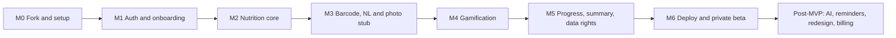

# Roadmap

Solo developer (AI agent) plus an owner review at each **🔒 review gate**. The next milestone
does not start until the owner approves. Estimates are working days.

## M0: Fork and setup (2–4 days)
- Fork openGym into this repo, keeping the git history and an `upstream` remote.
- Build and run locally without Docker. Run the frontend and api test suites and record the results.
- **Remove `catalogue/media/`** and the media pipeline; add free-exercise-db image mapping
  (placeholder where unmapped).
- Rebrand: name, icons, colors, manifest, "Source code" link, NOTICE credits to openGym.
- Add "basic mode" defaults that hide advanced openGym features.
- **Exit:** the app runs locally under the NXT FORM brand, upstream tests pass (or failures are
  documented), and no Gym visual media remains in the repo. 🔒

## M1: Auth and onboarding (3–5 days)
- Email + password sign-up as the main path. Google OIDC sign-in. Open sign-up (not invite-only).
- Onboarding flow → `lib/targets.js` (Mifflin–St Jeor, activity, goal, safety floor, macros) + tests.
- Target editing, calories-only mode, target history.
- **Exit:** a new user signs up (email or Google), completes onboarding and sees editable
  targets; changes are recorded in history. 🔒

## M2: Nutrition core (6–9 days)
- `api/food/` provider interface, USDA provider, cache, rate limiting.
- Nutrition monthly documents and sync endpoints.
- Food search → detail → portion → log. Diary by meal, edit/move/duplicate/delete, copy meal,
  past days.
- Custom foods, recipes, saved meals, favourites, recents. Water tracking.
- Home dashboard nutrition cards.
- Tests: portion math, recipe totals, daily totals, timezone boundaries.
- **Exit:** the full food logging flow works and totals reconcile. 🔒

## M3: Barcode, natural language and photo stub (3–5 days)
- Open Food Facts provider plus barcode scanning (native ML Kit; web BarcodeDetector plus fallback).
- Unknown barcode → manual entry → save as a custom food.
- CalorieNinjas natural-language parse (dev only, behind a flag).
- Photo estimate UI + stub estimator + confirmation flow.
- **Exit:** every failure path still allows manual logging, and no keys reach the client. 🔒

## M4: Gamification (5–8 days)
- `lib/gamification/` pure functions: XP, levels, streaks, freezes, missed-day penalty, quests,
  badges, titles, RPG stats + tests.
- Home: XP ring, level, streak, today's quests. Profile: character sheet, form, badges.
- Level-up / badge celebration moments (simple animations).
- **Exit:** XP recomputes correctly after edits and deletes, and all rules match GAMIFICATION.md. 🔒

## M5: Progress, weekly summary and data rights (3–6 days)
- Weight chart with goal line and 7-day average; nutrition history charts.
- Deterministic weekly summary screen.
- Cardio distance check. Nutrition added to the JSON/CSV export.
- Self-service account deletion. Attribution screen.
- Security tests (cross-user access, unauthenticated access, deletion).
- **Exit:** all PRD §9 flows pass. 🔒

## M6: Deploy and private beta (4–7 days)
- VPS setup, HTTPS, backups and a restore test, error logging without health data.
- PWA install test on Android Chrome and iOS Safari.
- Privacy policy draft and in-app feedback link.
- Cost check against the CAD $50/month budget.
- **Exit:** a small tester group uses the app end-to-end with no critical data-loss or auth bugs. 🔒

**MVP total: about 26–44 working days** (less than PRD v1's 34–57 because workouts come from openGym).

## Post-MVP backlog (ordered by owner priority, to be confirmed)
1. AI coach: weekly reports + workout plan generation (evaluate openGym's coach and choose a provider)
2. Real photo food recognition
3. Reminders/notifications (workout, weigh-in, water)
4. Full UI/UX redesign
5. Leaderboards/friends
6. Subscriptions/billing
7. Native app store releases (Capacitor); legal check on the AGPL app-store question
8. Database storage migration
