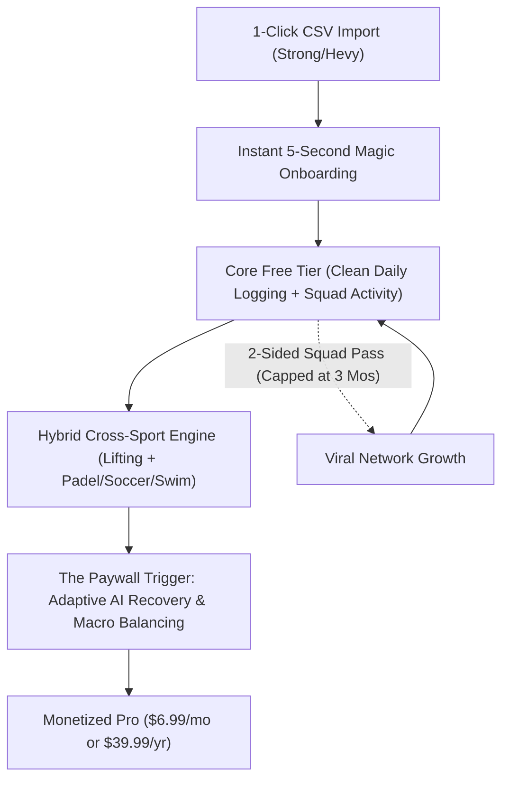

# MOV — Master Strategic Recommendations & Product Playbook

**Version:** 3.0 (Post-Board & Consumer Panel Rerun)  
**Date:** November 2026  
**Compiled from:**
- **Board of Directors:** Offers Lens (Alex Hormozi), Monopoly Lens (Peter Thiel), Product Lens (Steve Jobs)
- **Consumer Panel:** 20 Simulated Buyers across Multi-Sport Professionals, Lifters, Runners, and Gamers
- **Pricing Model:** Van Westendorp Price Sensitivity Meter (PSM)

---

## Executive Summary

MOV has evolved from a browser-based prototype into a powerful vision: **The Unified Operating System for the Modern Hybrid Athlete**.

The board unanimously voted **3 FUND IF, 0 PASS** (Average Score: **4.3 / 10**). The consumer panel revealed that while excitement around the feature set is high, **upfront paid conversion was 0%** because the combination of a generous free tier and an uncapped "Invite 5 friends for 1 free month" referral loop allowed power users to bypass paying entirely.

This playbook outlines the exact strategic, product, and monetization adjustments required to turn MOV into a high-growth, venture-fundable, and profitable fitness business.

---

## Pillar 1: Offer & Monetization Architecture (The Offers Lens)

### 1. Close the "Free Tier + Referral Loophole"
- **The Problem:** In the panel, 80% of hesitant buyers stated: *"The free tier already has all the core logging, sports, and RPG stats I need, and if I want Pro, I'll just invite 5 friends from my soccer/padel group to get it free."* Uncapped referral months allow your highest-cost power users to consume unlimited LLM inference and cloud storage without ever paying.
- **The Solution: The Two-Sided "Squad Pass"**
  - Replace the unilateral "Invite 5 friends" mechanic with a **Two-Sided VIP Workout Pass**.
  - Every user gets 2 passes to gift to active workout partners or teammates (giving them 1 month of MOV Pro).
  - When the invited friend logs their first full week of activity, the referrer receives 1 month of Pro credit.
  - **Hard Lifetime Cap:** Referrers can earn a **maximum of 3 free months lifetime**. After that, they must pay or convert to an annual subscriber.

### 2. Tighten the Freemium Value Boundary
Keep the daily habit completely friction-free, but gate high-utility, deep-intelligence features behind **MOV Pro**:

| Capability | Free Forever Tier | MOV Pro ($6.99/mo or $39.99/yr) |
| :--- | :---: | :---: |
| **Workout Logging** | Unlimited sets, reps, RPE, 1,300+ exercises | Unlimited sets, reps, auto-plate calculator |
| **Multi-Sport Tracking** | Padel, tennis, soccer, swim, run (duration & logs) | Dynamic METs & bodyweight calorie burn |
| **History & Cloud Sync** | 45-day rolling history + permanent cloud backup | **Unlimited multi-year history & PR analytics** |
| **CSV Import** | 1-click import from Strong/Hevy/CSV | Full historical timeline + comparative trends |
| **Meal Tracking** | Unlimited manual & barcode scanning | Unlimited AI photo & voice meal breakdown |
| **AI Coach** | 5 AI queries/scans per week | **Continuous dynamic macro & volume autoregulation** |
| **Social & Squads** | Activity feed, cheer/kudos, club leaderboards | Custom squad competitions & advanced stat comparisons |

### 3. Offer Stacking & Risk Reversal
- **Don't Compete as a Cheap Commodity:** Van Westendorp analysis proved that MOV's acceptable price corridor is **$2.03 to $7.99/month**. Competing at $4.99/mo with zero bonuses leaves perceived value low.
- **The Pro Stack:** Bundle high-perceived-value digital assets that cost $0 to deliver:
  - *The 12-Week Hybrid Athlete Periodization Blueprint* (PDF + in-app routine templates for lifters who run or play padel).
  - *Match-Day Fueling & Electrolyte Calculator*.
- **The Performance Guarantee:** Offer a **60-Day "Hit Your Milestone or 100% Refund"** for annual subscribers ($39.99/yr): If an athlete follows the Adaptive AI Coach's prescribed volume and macro targets for 60 days without hitting a strength or body composition benchmark, issue a no-questions-asked refund.

---

## Pillar 2: Eliminating Switching Friction (The Onboarding Superpower)

### 1. The 1-Click CSV Importer
The #1 barrier for experienced lifters switching apps is abandoning years of logged PRs and workout logs in Strong, Hevy, or FitNotes. 

- **Implementation Details:**
  - Build direct schema parsers for:
    - **Strong CSV export** (`Date, Workout Name, Exercise Name, Set Order, Weight, Reps, RPE, Distance, Seconds, Notes`)
    - **Hevy CSV export** (`title, start_time, end_time, exercise_title, set_index, set_type, weight_kg, reps, rpe`)
    - **Generic spreadsheet template**
  - **Verification Step (Pre-Commit Preview):** Address the panel's trust objection (*"Will it corrupt my data?"*) by showing an instant pre-import sanity report:
    > *"Found 412 workouts, 3,890 sets, and 14 PRs across Bench Press, Squat, and Deadlift. Map unmatched exercises (2 found) or import now?"*

### 2. The "5-Second Magic Moment"
When the import completes, do **not** dump the user into an empty dashboard. Immediately render an interactive **"All-Time Athletic Hall of Fame"**:
- Total career tonnage lifted (e.g., *"1,420,000 kg — Equivalent to 238 Elephants"*).
- Estimated 1RM progression curve over time.
- All-time strongest lifts and volume streaks.

---

## Pillar 3: Product Craft & Defending Against "The Frankenstein Trap" (The Product Lens)

### 1. The "Two-Tap" In-Gym Rule
The greatest danger Steve Jobs' framework highlighted is **feature bloat destroying craft**. An app that tries to do seven things at once risks making set logging laggy and cluttered on the gym floor.
- **Rule:** Logging a set must never take more than **2 taps** from the home screen:
  1. Open app $\rightarrow$ Auto-opens today's scheduled workout.
  2. Tap weight/reps $\rightarrow$ Tap checkmark (haptic tick, rest timer auto-triggers).
- Never interrupt an active workout with social notifications, friend feeds, or meal prompts.

### 2. Unified Energy Engine for Multi-Sport
Do not build 30 separate sport sub-apps. Frame sports (Padel, Tennis, Swimming, Soccer, Running) as **systemic metabolic inputs** that feed into the user's recovery and nutrition:
- **Calorie Calculation Formula Transparency:**
  Solve the panel's skepticism around calorie accuracy by displaying the scientific formula directly in the activity summary:
  $$\text{Calories Burned} = \text{Duration (min)} \times \left(\text{MET} \times 3.5 \times \frac{\text{Weight (kg)}}{200}\right)$$
  - *Example:* 60 min Padel (MET: 7.3) for 75 kg male $\rightarrow \approx 575\text{ kcal}$.
- **Dynamic Nutrition Balancing:** When an athlete logs a 90-minute soccer match, the Adaptive AI Coach automatically surfaces:
  > *"You burned 780 kcal playing soccer today. Your carbohydrate target has been increased by 65g to support glycogen replenishment for tomorrow's leg session."*

### 3. Elevate Gamification into "Authentic Athletic Progression"
Replace juvenile fantasy titles (e.g. *'Iron Vanguard'*, *'Dark Knight'*) with **Authentic Athletic Disciplines**:
- **Athletic Attribute Radar:**
  - **Strength** (Gym volume, 1RM milestones, compound lifts)
  - **Work Capacity & Aerobic Engine** (Swimming, running, cycling distance/pace)
  - **Agility & Court Endurance** (Padel, tennis, soccer, basketball match minutes)
- **Earned Athletic Milestones:**
  - *Tier I / II / III Hybrid Athlete*
  - *Century Club (100 Sets Logged)*
  - *Court Master (50 Match Hours)*

---

## Pillar 4: Defensible Monopoly & Organic Distribution (The Monopoly Lens)

### 1. Dominate the "Hybrid Athlete" Beachhead First
- **Do not compete against Strava or Playtomic on their home turf:** You will lose trying to build GPS route mapping better than Strava or court booking better than Playtomic.
- **The Blue Ocean Niche:** Target **Hybrid Athletes** — individuals who lift 2–4 times a week and play padel, soccer, or run on weekends. Right now, this demographic is forced to use Hevy for weights, Strava for running, MyFitnessPal for food, and Apple Notes for matches. MOV is their **all-in-one athletic home**.

### 2. Solve the "Ghost Town" Cold-Start Problem
- **Single-Player Utility First:** The app must be 100% delightful, fast, and useful if a user has zero friends on the app.
- **Hyper-Local Training Squads & Gym Leaderboards:**
  - Instead of a dead global feed, allow users to create small, high-density **"Squads"** (e.g., *'Downtown Padel Club'*, *'Iron Gym 6 AM Crew'*).
  - Mutual squad activity feeds generate instant camaraderie and accountability without needing millions of global users.

---

## Pillar 5: Step-by-Step Execution Roadmap

### Phase 1: Foundation & CSV Magic (Weeks 1–4)
- [ ] Build and verify the Strong and Hevy CSV import engine.
- [ ] Deliver the "5-Second Magic Onboarding" (interactive historical PR visualizer).
- [ ] Ensure the core 2-tap in-gym workout logger has zero lag and flawless cloud sync.

### Phase 2: Hybrid Sports & Metabolic Engine (Weeks 5–8)
- [ ] Implement multi-sport activity logging (Padel, Tennis, Swimming, Running, Soccer).
- [ ] Wire transparent MET-based calorie calculations factoring in user height, weight, and sex.
- [ ] Build the Athletic Attribute Radar (Strength, Agility, Work Capacity).

### Phase 3: Squads & Two-Sided Referral Pass (Weeks 9–12)
- [ ] Launch private "Squads" and micro-leaderboards.
- [ ] Deploy the Two-Sided VIP Squad Pass (capped at 3 earned months).
- [ ] Test viral coefficient ($K$-factor) on early beta cohorts.

### Phase 4: Pro Monetization & Adaptive AI Coach (Weeks 13–16)
- [ ] Integrate Stripe / Apple In-App Purchases for $6.99/mo or $39.99/yr.
- [ ] Launch the Adaptive AI Coach linking workout volume, multi-sport calorie burn, and dynamic macro targets.
- [ ] Implement the 60-Day Annual Performance Guarantee.
